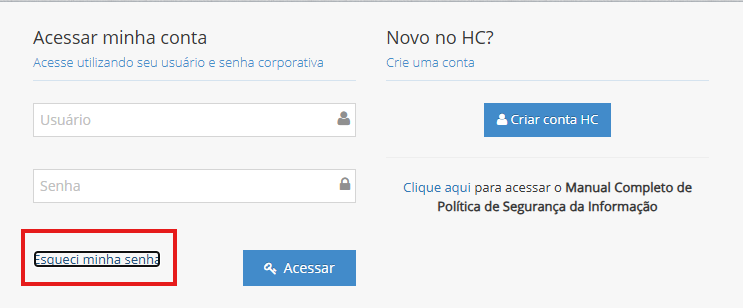

# RESET DE SENHA REDE

Proprietário: Lucas Sales

# Reset de senha

- Resete de senha de rede: Acessar o site [http://sistemashc.phcnet.usp.br/Conta/Login?ReturnUrl=http://hcemcasa.phcnet.usp.br/](http://sistemashc.phcnet.usp.br/Conta/Login?ReturnUrl=http://hcemcasa.phcnet.usp.br/)
1. Esqueceu senha

1. Vai pedir o CPF

1. Vai solicitar para escolher entre whatshapp ou e-mail - PREFERIR MANDAR POR E-MAIL. Vai confirmar o email e enviar senha padrão
2. Senha padrão é 12345678
3. Por padrão informar que a sincronização demora de 5min a 10min
4. Caso as informações estiverem erradas (telefone/e-mail) ligar para…………….

> Como é chamado rapido não é tão necessário abrir chamado
>